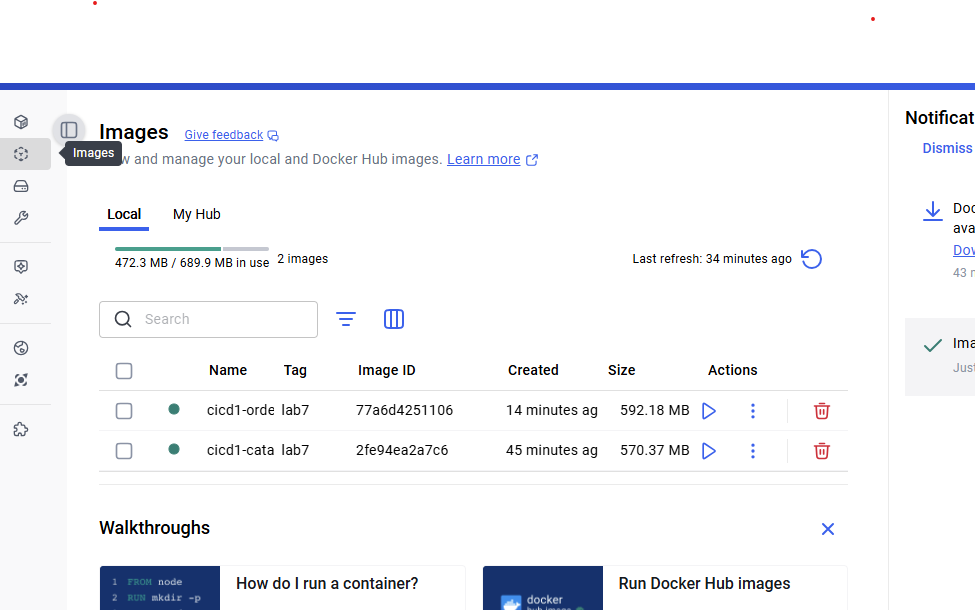
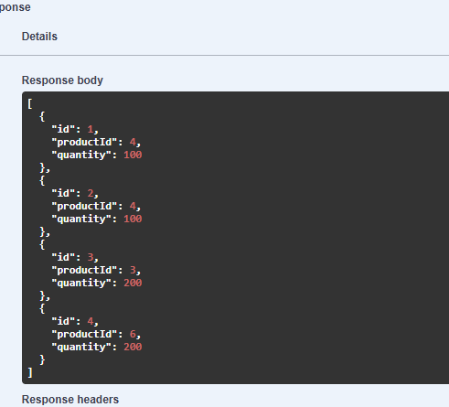

Order Service

The Order Service is responsible for creating and storing orders. For this lab, orders are stored temporarily in a Java List and there is no database yet.

Port

The Order Service runs on:
http://localhost:8082

Endpoints
Get all orders

GET /orders
Returns all orders currently stored in the service.

Create an order
POST /orders

Example request:

{
  "productId": 1,
  "quantity": 2
}

The service automatically gives each order an ID.

Swagger
Swagger UI is available at:
http://localhost:8082/swagger-ui/index.html

Project Structure
model - contains the PurchaseOrder class
service - contains the order service and temporary order list
controller - contains the REST endpoints

Other Service
The Catalog Service is a separate microservice and has its own GitHub repository.

The productId in an order refers to a product that belongs to the Catalog Service. However, the Order Service does not contact the Catalog Service yet. This is intentional for Lab 1.

Current Version
This is Lab 1, so the service currently uses temporary in-memory storage. JPA and a database will be added later.

https://dbfiddle.uk/Qs5rl21J

Why must Maven package run before Docker build?
Maven package must run first because it compiles the Java application and creates the JAR file. Docker needs this JAR file to build the image, so without it, the Docker build may fail.

What is the difference between an image and a running container?
A Docker image is a blueprint that contains the application and everything it needs to run. A container is a running instance created from that image.

What does 8082:8082 mean? Does EXPOSE 8082 alone make the application accessible from Windows?
The first 8082 is the port on the Windows machine, and the second 8082 is the port inside the Docker container. EXPOSE 8082 only documents the container port and does not make the application accessible from Windows. We need 8082:8082 in Docker Compose to publish the port.

Why might a Feign request to localhost:8081 fail when Order is running in its own container?
It might fail because localhost inside a Docker container refers to that same container, not the Catalog container. We should use the Docker Compose service name, such as http://catalog:8081, so Order can communicate with Catalog.

Why did the Catalog Product survive after docker compose down and up -d? What would happen with an in-memory H2 database?
The Catalog Product survived because the database data was stored in a persistent Docker volume, which is not removed by docker compose down by default. However, if we used an in-memory H2 database, the data would be lost when the container stops because the database only exists in memory.

